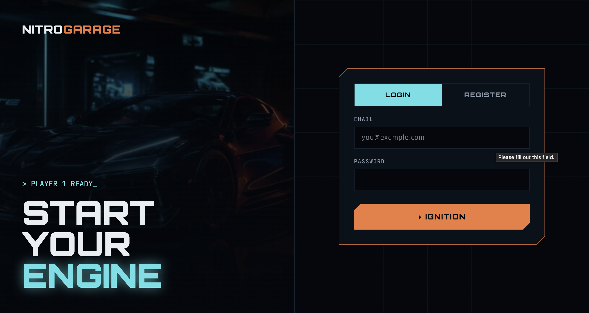
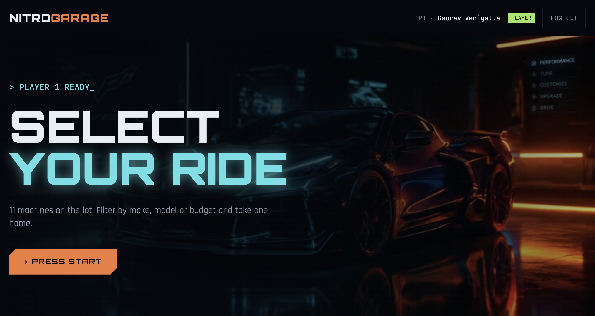
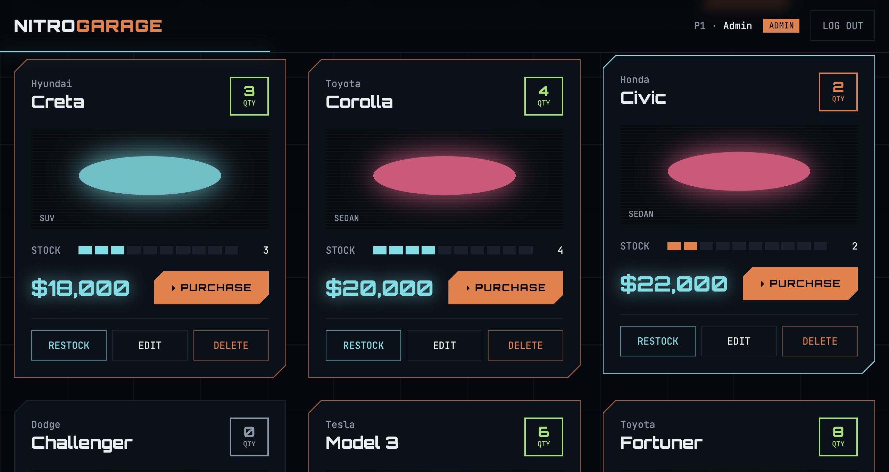
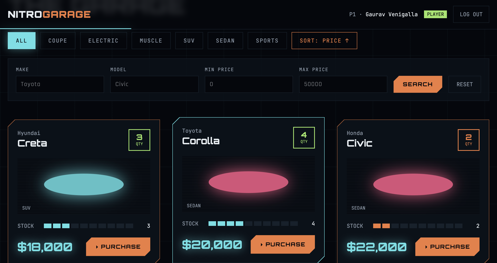
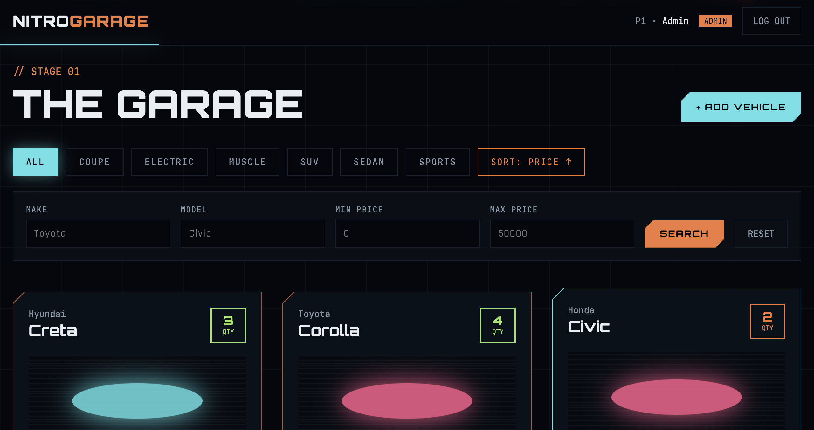

# Nitro Garage: Car Dealership Inventory System

A full-stack inventory system for a car dealership. Users can register, log in, browse and search vehicles, and purchase them. Admins can also add, edit, delete and restock vehicles. The backend was built with Test-Driven Development (Red → Green → Refactor), and the commit history shows each step.

**Live demo:** https://car-dealership-inventory-swart.vercel.app/

## Tech Stack

| Layer | Tech |
|---|---|
| Backend | Node.js, TypeScript, Express 5 |
| Database | PostgreSQL (Neon, cloud) with the Prisma ORM |
| Auth | JWT + bcrypt |
| Backend tests | Jest + Supertest (against a separate Neon test branch) |
| Frontend | React, TypeScript, Vite, Tailwind CSS v4, React Router |
| Frontend tests | Vitest + React Testing Library |

## Features

- **Auth:** register and login with JWT. Passwords are hashed with bcrypt, and new users are always `USER`; the role can't be set from the client.
- **Vehicles:** list, search (by make, model, category and price range, case-insensitive), add, update and delete.
- **Inventory:** purchase decreases quantity by 1 and is rejected at 0. Restock increases quantity (admin only).
- **Role-based access:** enforced on the backend with middleware, not just hidden in the UI.
- **UI:** a game-inspired dark theme with scroll-reveal animations, a scroll progress bar, category filters, sorting by price, a purchase button that's disabled when out of stock, admin controls, toast notifications and a responsive layout.

## API

| Method | Endpoint | Access |
|---|---|---|
| POST | `/api/auth/register` | Public |
| POST | `/api/auth/login` | Public |
| GET | `/api/vehicles` | Logged in |
| GET | `/api/vehicles/search?make=&model=&category=&minPrice=&maxPrice=` | Logged in |
| POST | `/api/vehicles/:id/purchase` | Logged in |
| POST | `/api/vehicles` | Admin |
| PUT | `/api/vehicles/:id` | Admin |
| DELETE | `/api/vehicles/:id` | Admin |
| POST | `/api/vehicles/:id/restock` (body `{ "quantity": n }`) | Admin |

**Design decisions:**
- The spec marks POST and PUT on `/api/vehicles` as "protected". I made them **admin-only**, because the frontend spec assigns add/update/delete to admins, and leaving them open would let any user change prices through the API.
- **Purchase is atomic:** a single `updateMany ... where quantity > 0` query, so two simultaneous buyers can't both take the last car.
- **Login returns the same 401 message** for an unknown email and a wrong password, so email addresses can't be discovered.
- Admin accounts are created by a seed script, not through registration.

## Project Structure

```
backend/
  prisma/            schema, migrations, seed
  src/
    routes/          URL → controller
    controllers/     HTTP request/response
    services/        business logic + validation
    middleware/      authenticate, requireAdmin, errorHandler
    utils/AppError   errors carrying an HTTP status
  tests/             Jest + Supertest integration tests
frontend/
  src/
    api/             fetch client, auth + vehicle API
    context/         AuthContext (logged-in user)
    components/      VehicleCard, FilterBar, Navbar, modal, Reveal
    pages/           AuthPage, GaragePage
```

## Running Locally

**Prerequisites:** Node 20+ and two PostgreSQL databases (for example, a free Neon project with a `test` branch).

### Backend
```bash
cd backend
npm install
cp .env.example .env              # set DATABASE_URL and JWT_SECRET
# create .env.test with DATABASE_URL (test database) and JWT_SECRET
npx prisma migrate deploy         # create tables
npm run db:migrate:test           # create tables in the test database
npm run db:seed                   # admin user + sample cars
npm run dev                       # http://localhost:4000
```

### Frontend
```bash
cd frontend
npm install
cp .env.example .env              # VITE_API_URL=http://localhost:4000/api
npm run dev                       # http://localhost:5173
```

**Default admin:** `admin@dealership.com` / `admin123` (change it via `ADMIN_EMAIL` / `ADMIN_PASSWORD` before seeding).

## Screenshots

| Login | Hero |
|---|---|
|  |  |

| Garage (admin) | Garage (user) |
|---|---|
|  |  |



## Test Report

### Backend: Jest + Supertest (`cd backend && npm run test:coverage`)
```
PASS  tests/inventory.test.ts
PASS  tests/vehicles.test.ts
PASS  tests/vehicles.search.test.ts
PASS  tests/auth.register.test.ts
PASS  tests/auth.login.test.ts
PASS  tests/auth.middleware.test.ts
PASS  tests/health.test.ts

Test Suites: 7 passed, 7 total
Tests:       54 passed, 54 total
```

| Coverage | Statements | Branches | Functions | Lines |
|---|---|---|---|---|
| All files | 89.65% | 79.12% | 97.22% | 89.76% |

| Area | What is tested |
|---|---|
| Auth: register | success, hashed password, role can't be injected, missing fields, invalid email, short password, duplicate email |
| Auth: login | valid token, wrong password, unknown email (same message), missing fields |
| Middleware | missing, malformed, wrong-secret and expired tokens; user vs admin access |
| Vehicles CRUD | admin create/update/delete, 403 for users, 401 without token, 404 unknown id, validation errors |
| Search | make, model, category (partial, case-insensitive), price range, combined filters, invalid price |
| Inventory | purchase decrements, 400 when out of stock, restock increments, invalid quantities, 403/404 |

### Frontend: Vitest + React Testing Library (`cd frontend && npm test`)
```
✓ src/components/FilterBar.test.tsx (3 tests)
✓ src/components/VehicleCard.test.tsx (6 tests)

Test Files  2 passed (2)
     Tests  9 passed (9)
```

The backend tests run against a real PostgreSQL test database (a separate Neon branch) rather than mocks, so they cover validation, auth, roles, the database and the HTTP layer together.

## My AI Usage

**Tools used:**
- **Claude (claude.ai chat):** my main assistant throughout the project.
- **Lovable:** used to explore a visual design direction for the UI (the game/"Need for Speed" theme), which I then had rebuilt in this project's React + Tailwind code.

**How I used them:**
- **Planning:** I asked Claude to analyse the problem statement, recommend a free tech stack, and decide which endpoints should be admin-only.
- **TDD workflow:** for each backend feature, Claude wrote the failing tests first. I ran them to confirm they failed (red) and committed, then added the implementation, ran it to green, and committed. Refactors were separate commits, such as splitting routes into controller/service layers and sharing test fixtures.
- **Code generation:** most backend and frontend code was generated by Claude, then reviewed and run by me. I asked for explanations of anything I didn't understand before committing.
- **Debugging:** Claude helped fix setup issues: TypeScript 7 incompatibility with ts-jest, Express 5 route-param types, a misplaced test file, Tailwind v4 plugin config, and test cleanup in Vitest.
- **Docs:** Claude drafted this README, which I edited.

Every commit where AI helped includes a `Co-authored-by: Claude <noreply@anthropic.com>` trailer.

**Reflection:** AI made me much faster, especially with setup, boilerplate and debugging config errors, which let me finish a full-stack app in a weekend. Writing tests first was the best part: the tests caught real mistakes (missing code, type errors) immediately. The main risk is accepting code without understanding it, so I made a rule to go through each piece before committing. I also learned to check AI-generated commands carefully: one used `;` instead of `&&`, which let a commit through with failing tests, and I fixed it in a follow-up commit.
